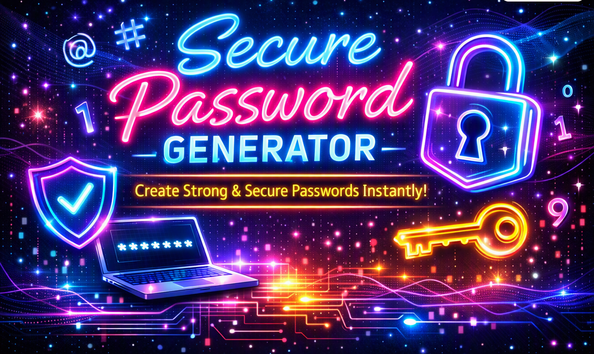
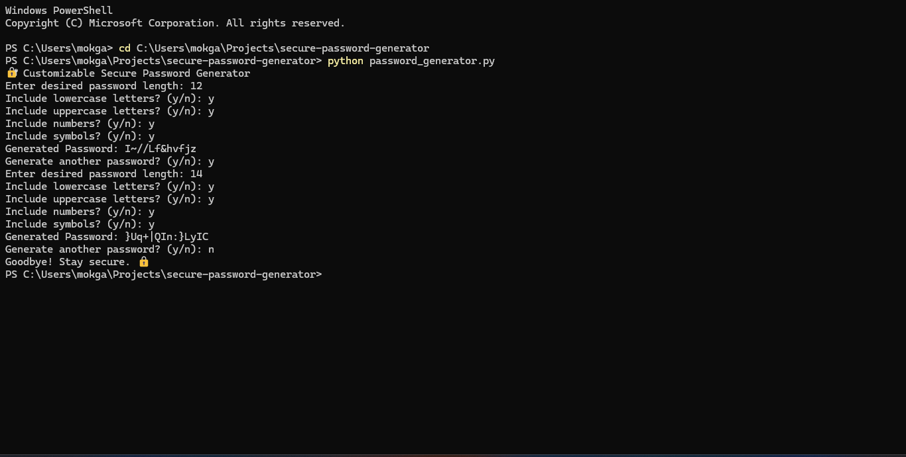
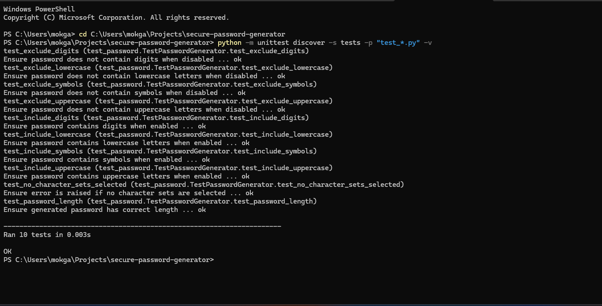

# 🔐 Secure Password Generator


A Python application that generates secure and customizable passwords.  
Users can choose password length and decide whether to include lowercase, uppercase, digits, and symbols.

---

## 🚀 Features
- Random password generation
- Customizable length
- Toggle inclusion of lowercase, uppercase, digits, and symbols
- Error handling if no character sets are selected
- Unit tests for reliability

---

## 📸 Screenshots

### 🧩 App Run


### 🧪 Tests Passed


---

## 📂 Project Structure
secure-password-generator/
│── README.md
│── requirements.txt
│── password_generator.py
│── utils/
│   └── init.py
│── tests/
│   └── test_password.py


---

## ⚡ Setup & Usage

### 1. Clone the repo
```bash
git clone https://github.com/your-username/secure-password-generator.git
cd secure-password-generator
```

### 2. Run the generator
```bash
python password_generator.py
```
You’ll be prompted for:

- Password length

- Whether to include lowercase, uppercase, digits, and symbols


### 3. Example
```bash
🔐 Customizable Secure Password Generator
Enter desired password length: 12
Include lowercase letters? (y/n): y
Include uppercase letters? (y/n): y
Include numbers? (y/n): y
Include symbols? (y/n): n
Generated Password: aB9xYzQwLmNp
```
---

## 🧪 Running Tests
From the project root:

```bash
python -m unittest discover -s tests -p "test_*.py" -v
```
---

## 📘 Skills Learned
- Python basics

- Random module

- String manipulation

- Unit testing with `unittest`

## ✅ Future Improvements
- Add GUI or web interface

- Save generated passwords securely

- Add entropy/strength meter

